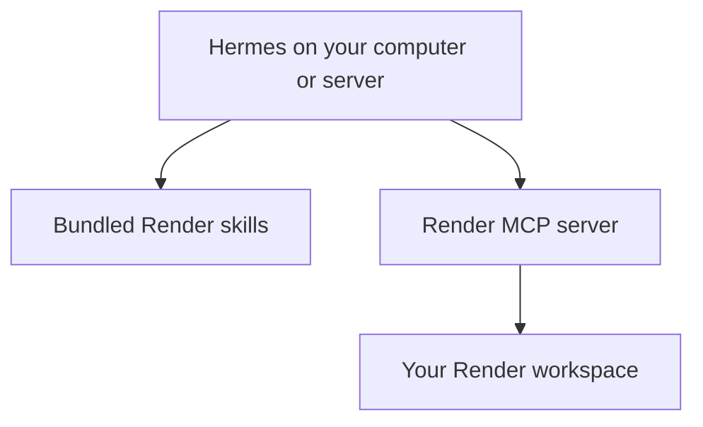

<div align="center">

# Render for Hermes

Use Render's existing skills and tools from Hermes to deploy, debug and manage applications.

[](https://hermes-agent.nousresearch.com/docs/developer-guide/plugins) [](https://github.com/render-oss/skills) [](LICENSE)

[Quickstart](#quickstart) · [Try it](#try-it) · [How it works](#how-it-works) · [Troubleshooting](#troubleshooting)

</div>

This community plugin bundles Render's maintained skills and connects Hermes to the [Render MCP server](https://render.com/docs/mcp-server). MCP (Model Context Protocol) is how Hermes discovers and calls Render's tools. A first check can list the workspaces your account can access without changing anything.

The skills come from [render-oss/skills](https://github.com/render-oss/skills). Included files are unchanged. This package is maintained by [Ojus Save](https://github.com/ojusave); catalog inclusion is subject to Nous Research review.

## Quickstart

### Prerequisites

- [Hermes installed and connected to a model](https://hermes-agent.nousresearch.com/docs/getting-started/installation), with portable plugin and remote MCP support. If these features are unavailable, run `hermes update` first.
- A Render account and a [Render API key](https://dashboard.render.com/u/settings#api-keys) for the workspaces you intend to use.
- For Blueprint validation and command-line operations, the [Render CLI](https://render.com/docs/cli) installed on the same computer or server as Hermes.

Run the following commands in your computer's terminal, from any directory. They install the plugin on the machine running Hermes.

### 1. Prepare Hermes and install

Enable Hermes's MCP support, then install the plugin without enabling it:

```bash
hermes pm install --extra mcp
hermes plugins install ojusave/render-hermes-plugin --no-enable
```

Review Hermes's source and security prompts. The package adds skills and a remote tool connection. It has no custom runtime code or plugin-specific Python dependencies; the first command installs Hermes's MCP support. Successful installation leaves it disabled until you enable it.

### 2. Add your Render key

Ask Hermes where the active profile stores environment settings:

```bash
hermes config env-path
```

Open the printed file in a text editor. Create it if it does not exist. Add this line, replacing the example value with your API key:

```dotenv
RENDER_API_KEY=your_render_api_key
```

Save the file. This key lets Render's server act with your account's permissions. Keep it in that profile file, outside your project and plugin repository. Do not paste it into chat. If you already keep `RENDER_API_KEY` in the active profile or a Hermes-supported secret manager, use that existing value.

### 3. Enable and check the connection

```bash
hermes plugins enable render-platform
hermes plugins list
hermes plugins show render-platform
```

The plugin should show as enabled. Start a new Hermes chat so it discovers the added skills and tools, then use the read-only prompt below to verify the connection. If you use Hermes through its messaging gateway, restart it with `hermes gateway restart` after changing plugins or credentials.

Hermes asks for approval when the Render server does not explicitly mark a tool as read-only. This currently includes the workspace listing. Review the requested tool and choose **Allow once** for that check. Unattended runs reject calls that need approval. Your account permissions still apply.

If you already configured a server named `render` in Hermes, that configuration takes precedence over the package's connection, including its authentication and approval settings. See [existing connections](#existing-render-connection) before relying on the package's defaults.

## Try it

Start Hermes in the same terminal:

```bash
hermes
```

Ask:

```text
Use the Render plugin's skills to check that my Render connection works.
List the workspaces I can access, but do not select a workspace or change anything.
```

When Hermes asks to run `list_workspaces`, choose **Allow once**. Success means Hermes returns the workspaces from the real Render connection. An empty list or authentication error needs investigation before deploying anything.

An abbreviated response from a successful run, with workspace names omitted:

```text
Your Render connection works. The read-only workspace listing returned:
[workspace names omitted]
No workspace was selected and nothing was changed.
```

For a local configuration task, open Hermes in your application's directory and ask:

```text
Use the Render deployment skill to prepare a render.yaml for this project.
Use paid compute, explain the proposed resources, and validate the file with
Render's CLI. Do not deploy, commit, push or change existing services.
```

This produces a local deployment configuration. A valid file is not a deployed application. Review it before asking Hermes to create or modify Render resources; those operations can incur charges.

## How it works



[plugin.json](plugin.json) describes the package and its approval setting. [mcp.json](mcp.json) supplies the HTTPS endpoint and a reference to `RENDER_API_KEY`; Hermes resolves the key from the active profile when connecting. [skills/](skills/) contains the existing Render instructions, references and templates.

Hermes and local file operations run on your computer or server. Render tool requests go to Render's hosted MCP server and can inspect or change resources in your account. CLI operations use the Render CLI's own authentication on the host. The package adds no background process or telemetry.

This plugin does not move terminal execution into a sandbox. The separate [Render Sandboxes plugin](https://github.com/ojusave/hermes-plugin-render) provides that behavior and is not required here.

## Included skills and source

The package includes deployment, debugging, monitoring, MCP setup, CLI use, Blueprints, web and private services, static sites, background workers, cron jobs, Workflows, environment variables, disks, domains, networking, Postgres, Key Value, scaling and Heroku migration.

The dedicated `render-docker` skill is excluded from this initial release because Hermes's catalog scanner rejects a cleanup command in its Dockerfile example. The upstream skill is unchanged. Other included skills retain their original Docker-related guidance. Remaining scanner warnings in the included examples are disclosed in the catalog submission.

[upstream.json](upstream.json) records the exact Render source commit and every included file's checksum. Updates are reviewed package releases; an installed plugin does not download new skill instructions automatically.

## Troubleshooting

### Plugin installed but skills are missing

Check `hermes plugins list`, enable `render-platform`, and start a new chat. Ask Hermes to list its available skills. Plugin skills have qualified names assigned by Hermes, so let the agent discover them rather than guessing a name.

### Missing or rejected API key

Run `hermes config env-path` and confirm that you edited the active profile's file. Check that the key is still valid for your Render account, then restart Hermes and retry the read-only workspace prompt. Keep the key out of screenshots and logs you share.

### Existing Render connection

A `render` entry under `mcp_servers` in your Hermes configuration overrides this plugin's connection. Keep it if it is intentional. If you want the plugin to own the connection, back up that entry and run `hermes mcp remove render`, then restart Hermes. The package's connection and approval setting apply once the override is removed.

### Blueprint validation is unavailable

Install the Render CLI using its [official instructions](https://render.com/docs/cli), authenticate with `render login`, and check `render --version`. A working MCP connection does not install or authenticate the CLI.

## Disable or remove

```bash
hermes plugins disable render-platform
hermes plugins remove render-platform
```

Restart Hermes afterward. Removal takes away the package's skills and connection; it does not delete Render services or the API key you added to your profile. Remove that key separately if nothing else uses it, or revoke it in Render account settings.

## Maintainers

The source record and package checks live in [upstream.json](upstream.json), [scripts/verify_package.py](scripts/verify_package.py) and [validation/results.json](validation/results.json).

Update skill files from a reviewed commit of `render-oss/skills`, preserve their contents and license, update the source record, and validate the resulting package. A catalog update requires a new PR with the full commit identifier so Nous can review the exact version.

## License

[MIT](LICENSE). Render owns the upstream skill content; this repository provides its Hermes packaging.
